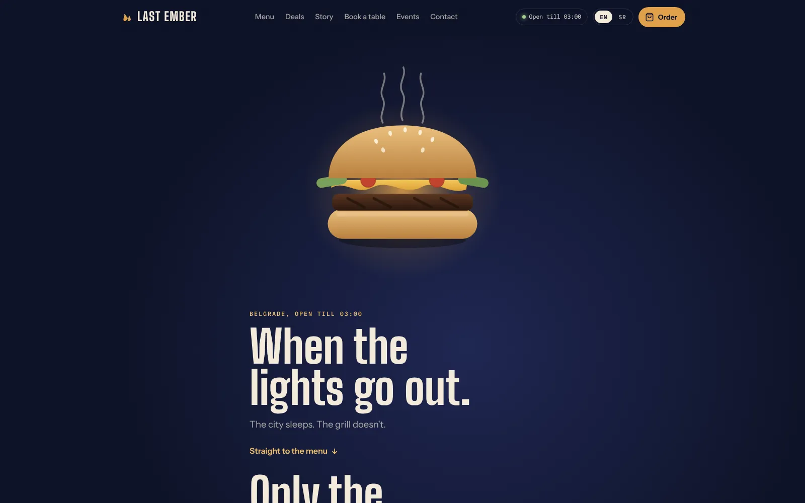
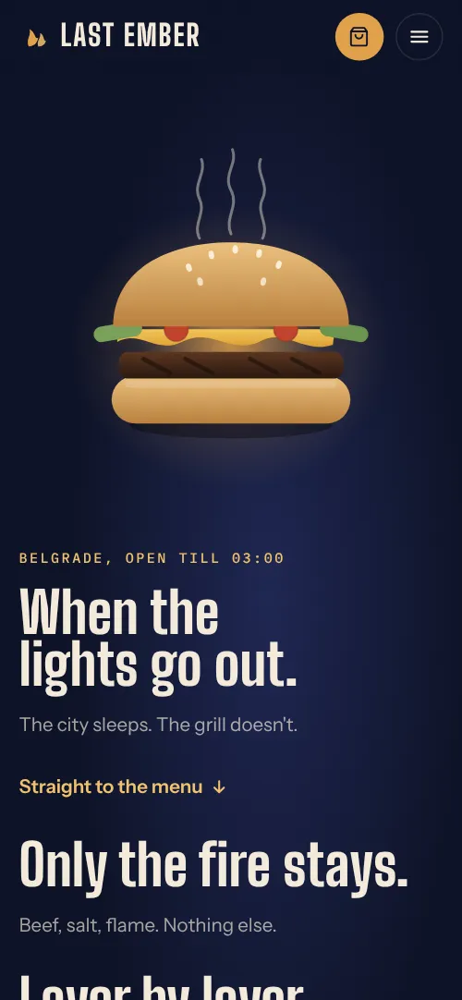

# Last Ember

Website for Last Ember, a fictional late-night burger bar in Belgrade (open Tue to Sun, 20:00 to 03:00).
Plain HTML, CSS and JavaScript. No build step, no frameworks, no server needed.

**[Open the live site](https://vojvodixdev.github.io/last-ember/)**

<p>
  
  
</p>

## Folder structure

```
last-ember/
├── index.html            page structure and all sections
├── css/
│   └── style.css         all styles (colours and fonts are at the top, in :root)
├── js/
│   ├── translations.js   every piece of text, in English and Serbian
│   └── app.js            menu, cart, booking, forms, language switch, scroll animation
└── assets/
    ├── favicon.svg       browser tab icon
    └── og.jpg            preview image when the link is shared
```

## How to run it

Open `index.html` in a browser. That's it.

If you want a local server (useful for testing on a phone in the same Wi-Fi):

```
npx serve .
```
or
```
python3 -m http.server 8000
```

## How to edit common things

| What | Where |
|---|---|
| Any text, in either language | `js/translations.js`. Each entry is `["English", "Srpski"]`. |
| Dishes, prices, allergens, extras | `js/app.js`, the `MENU`, `EXTRAS` and `COMBOS` lists |
| Weekly specials | `js/app.js`, the `SPECIALS` list (0 = Sunday, 1 = Monday...) |
| Legal pages | `js/app.js`, the `LEGAL` list |
| Promo codes | `js/app.js`, `PROMOS` (now `EMBER10`, `NIGHT15`, `FIRST20`) |
| Delivery neighbourhoods | `js/app.js`, `IN_ZONE` and `NEAR` |
| Opening hours logic | `js/app.js`, `isOpenAt()` and `nextOpening()` |
| Colours and fonts | `css/style.css`, the `:root` block at the top |
| Address, phone, email | `index.html` (contact section and footer) and `js/translations.js` |

The default language is English. The EN / SR button switches everything and the choice is remembered in the browser.

## What works and what is simulated

Works fully in the browser:
- Scroll-built burger hero (static version for people with reduced motion turned on)
- Menu with categories, search, filters, dish details, allergens and extras
- Cart: quantities, extras, pickup or delivery, delivery fee (free over 2,000 RSD), promo codes, tip, time slots and pre-ordering when closed, saved between visits
- Order confirmation styled as a kitchen ticket, with status steps
- Table booking (Mondays blocked) and a contact form
- Delivery area check, live open/closed status, today highlighted in hours and specials
- English and Serbian

Simulated (there is no backend):
- Orders, bookings and messages are not sent anywhere. Each form has a
  `submit` or `click` handler in `js/app.js` that currently shows a success message.
  To make them real, send the data from those handlers to your own API, a form
  service (Formspree, Netlify Forms, Basin) or an ordering system.

## Putting it online for free

- **Netlify**: drag the whole `last-ember` folder onto https://app.netlify.com/drop
- **GitHub Pages** (how the live site is published): the workflow in `.github/workflows/pages.yml` deploys the site on every push to `main`. In the repository settings choose **Pages → Source: GitHub Actions**.
- **Vercel** or **Cloudflare Pages**: import the folder, no build command, output directory `.`

## Notes

- Fonts load from Google Fonts (Big Shoulders Display, Instrument Sans, IBM Plex Mono). Without internet the page falls back to system fonts.
- The brand, menu and address are fictional placeholders. Replace them before using the site for a real business.
- The page carries `noindex` so the fictional restaurant does not show up in search results. Remove it for a real launch.

## License

© 2026 Nikola Vojvodić. All rights reserved. The code is public so it can be read and evaluated as part of my portfolio; it is not open source. See [LICENSE](LICENSE) for what is and isn't allowed.
